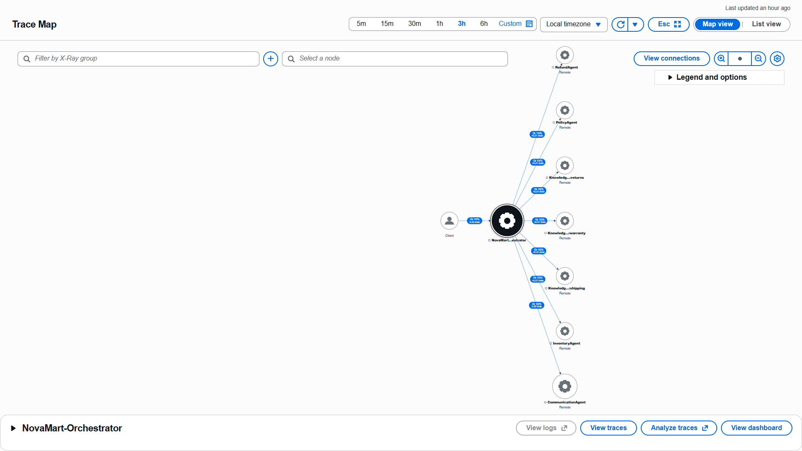

# NovaMart Agent Hardening: when an instruction is not a control

**An adversarial, end-to-end test of a deployed multi-agent system on Amazon Bedrock AgentCore. It exposed failures that a 120/120 automated suite and a human review both missed. The fix moves a safety rule from the prompt into code, and is verified before and after in production.**

This repository continues [**novamart-multi-agent**](https://github.com/Augamila/novamart-multi-agent), a five-agent customer-service system built with the [Strands Agents SDK](https://strandsagents.com/) and deployed to [Amazon Bedrock AgentCore Runtime](https://docs.aws.amazon.com/bedrock-agentcore/latest/devguide/runtime-how-it-works.html). That system passed its full automated suite and an independent review. I then tested it the way a model validator would: through the deployed runtime, with inputs the suite does not grade, reading every reply rather than checking a score. The test found that the system's most important behavioural rule existed only as a sentence in a prompt, and that the model did not always follow it.

This repository holds the hardened system, the evidence from before and after the change, and an account of what was done, why, what the results show and what they imply.

---

## Headline results

| | Baseline ([novamart-multi-agent](https://github.com/Augamila/novamart-multi-agent)) | Hardened (this repo) |
|---|---|---|
| Automated suite (`tests/test_agent.py all`) | 120 / 120 | 120 / 120 |
| Guardrail in isolation (ApplyGuardrail, 12 scored cases) | 12 / 12 | 12 / 12 |
| End-to-end on the deployed runtime (8 prompts) | 7 / 7 scored cases allowed or blocked correctly, but **2 of 8 replies leaked internal text** | **8 / 8** as intended; no internal text reached the customer |
| Orchestrator text reaching the customer on an adversarial prompt | Yes: cited its "routing rules" and echoed the session ID | No: fixed clarification (`reply_source = fallback`) |
| Internal narration in customer replies | "…with **no agent findings**…" in the discount reply | Removed by a deterministic filter, which logs each removal |
| Unverified tier claim to a Standard customer | "As a premium customer, you enjoy…" | Tier stated only when the InventoryAgent has confirmed it |
| Arithmetic working consistent with the stated total | Yes ($14.995) | Yes ($14.995), after fixing a regression the first fix introduced |
| Who decides what the customer sees | A sentence in the orchestrator's prompt | `final_customer_reply()`, in code, on every path |

The evidence for every row is in [`docs/evidence/`](docs/evidence/). See [Results](docs/05-results.md).



---

## What was done, in one page

**1. Tested the deployed system end to end.** [`tools/run_guardrail_e2e.ps1`](tools/run_guardrail_e2e.ps1) sends eight prompts through the live AgentCore Runtime: two controls, five that the guardrail should block (price haggling, price matching, a competitor comparison, a legal threat and a card number), and one prompt-injection attempt. It then runs the same guardrail version through the ApplyGuardrail API alone, so both layers are recorded side by side. ([Method](docs/02-method.md))

**2. Read the replies, not just the verdicts.** All seven graded cases behaved as intended. Reading the text showed three problems the pass/fail columns hide ([Findings](docs/03-findings.md)):
- **F1.** The orchestrator, whose prompt says "You never answer the customer yourself", answered the injection prompt itself. Its reply referred to its "routing rules" and repeated the session and customer IDs.
- **F2.** The CommunicationAgent narrated its own pipeline in a customer reply ("a calculation question with no agent findings").
- **F3.** A Standard-tier customer was told "As a premium customer, you enjoy…", a tier no agent had looked up. This was already present in the baseline's own test log.

It also confirmed two things that did work: refund idempotency held in production, and the guardrail matched ApplyGuardrail on every graded case.

**3. Found the root cause.** The runtime's reply path was `communication_agent output or str(response)`. Whenever the orchestrator skipped the CommunicationAgent, the orchestrator's own text went straight to the customer. The only thing standing in the way was an instruction in a prompt.

**4. Moved the rule into code.** [`final_customer_reply()`](src/agent_orchestrator.py) is now the single path to the customer in `test`, `chat` and the runtime ([Design of the fix](docs/04-design-of-the-fix.md)). It:
- accepts the CommunicationAgent's text;
- passes the guardrail's configured message through when the guardrail intervened;
- otherwise returns a fixed clarification.

Every reply then passes a deterministic filter that removes sentences containing internal markers. Each non-standard outcome is logged, and the runtime returns a `reply_source` field so outcomes can be counted. Two prompt changes cover what code cannot easily check: keep intermediate arithmetic unrounded, and never state a tier without InventoryAgent data.

**5. Iterated, re-verified and redeployed.** The first version of the fix caused a regression: the working showed $14.99 instead of $14.995, so the steps no longer matched the total. Version 2 corrected that, and the regression is documented rather than hidden. The suite still scores 120/120. On the redeployed runtime the same eight prompts gave 8/8: controls `[communication_agent]`, blocked prompts `[guardrail]`, injection `[fallback]`.

**6. Caught the control working.** On the hardened build, the CommunicationAgent was explicitly instructed not to describe the question type. It still wrote "This is a calculation question with no order, policy, or refund details in the workflow context…". The filter removed that sentence and logged `Removed 1 sentence(s) containing internal markers`; the customer never saw it. This is the clearest evidence in the project that **prompting reduces a behaviour, while only code guarantees the outcome.**

## Why it matters

The baseline was not careless. It already had a guardrail, deterministic refund checks, sequential tool execution, tracing and a perfect automated score. The failures sat in the gap between **what the suite graded** and **what the system was told to do**. That gap is where agentic systems fail in practice, and where most AI governance frameworks now ask firms to look. [Implications](docs/06-implications.md) develops this into five points:
1. A behavioural rule in a prompt is a *control objective*, not a *control*.
2. Test the paths the acceptance criteria don't grade.
3. A prompt edit is a model change and needs regression testing; the rounding regression proves it.
4. A single adversarial pass is not evidence of robustness.
5. Make every exception path observable.

These map directly to the validation dimensions in my companion project, [agentic-model-validation](https://github.com/Augamila/agentic-model-validation), and to supervisory expectations such as [SR 26-2](https://www.federalreserve.gov/supervisionreg/srletters/SR2602.htm) and the [OWASP Top 10 for Agentic Applications](https://genai.owasp.org/).

## Documentation

| Document | Contents |
|---|---|
| [01 Background and motivation](docs/01-background-and-motivation.md) | The baseline system, what had already been verified, and why that was not enough |
| [02 Method](docs/02-method.md) | Test design, the eight prompts and why each was chosen, the two-layer comparison, before/after protocol, evidence handling |
| [03 Findings](docs/03-findings.md) | Each finding with the verbatim evidence, root cause and severity, plus what held up |
| [04 Design of the fix](docs/04-design-of-the-fix.md) | `final_customer_reply()` line by line, the marker filter, the prompt changes, alternatives considered and rejected |
| [05 Results](docs/05-results.md) | Before/after tables, the local and deployed verification, the regression and its correction, the deployment incident |
| [06 Implications](docs/06-implications.md) | For agent design, for testing and validation, for governance and model risk, for other domains |
| [07 Limitations and next steps](docs/07-limitations-and-next-steps.md) | What the fix does not do, residual risks and a prioritised roadmap |
| [08 Reproducing](docs/08-reproducing.md) | Deploying, running the suite and the end-to-end test, tearing down |
| [System overview](docs/system-overview.md) | Full reference for the system: architecture, agents, request flow, design decisions, safety controls, observability, the limitations register and lessons learned |
| [Evidence](docs/evidence/) | Raw logs from every run, the 120/120 suite output and the full code diff from baseline to hardened |

## What changed in the code

All behavioural changes are in [`src/agent_orchestrator.py`](src/agent_orchestrator.py). The full diff is in [`docs/evidence/baseline-to-hardened.diff`](docs/evidence/baseline-to-hardened.diff).

| Change | Where | Purpose |
|---|---|---|
| `final_customer_reply()` and `_remove_internal_sentences()` | new "FINAL REPLY" section | Decide the customer's reply in code; filter internal markers |
| Used by `run_test_scenarios`, `run_chat`, `run_serve`; `reply_source` in the runtime response | three call sites | One path for every mode; countable outcomes |
| `GUARDRAIL_BLOCKED_INPUT_MESSAGE` / `..._OUTPUT_MESSAGE` constants | above `create_guardrail()` | Single source for the guardrail text and its recognition |
| CommunicationAgent prompt | `build_communication_agent()` | No pipeline narration; unrounded intermediate values; no tier claims without data |
| Expanded docstrings on the three retriever tools | `build_policy_agent()` | The tool contract the retriever models see |
| `NotImplementedError` guards replaced by actionable `RuntimeError`s | deploy and memory steps | Fail with a cause and a next step |
| `tools/run_guardrail_e2e.ps1` | new | The end-to-end test harness |

The architecture is unchanged: an orchestrator on Claude Haiku 4.5; Inventory, Refund, Policy and Communication agents on Claude Sonnet 4.5; three parallel retriever agents over Bedrock Knowledge Bases on S3 Vectors; DynamoDB workflow state with optimistic locking; Bedrock Guardrails; AgentCore Memory; CloudWatch and X-Ray. See the [system overview](docs/system-overview.md#2-architecture).

## Repository layout

```
src/agent_orchestrator.py      agents, routing, guardrail, deployment and the final-reply control
tools/run_guardrail_e2e.ps1    end-to-end test against the deployed runtime
tools/validate_guardrail.py    guardrail-only test via ApplyGuardrail
tests/test_agent.py            120-point automated suite (from the course scaffold)
infrastructure/                CloudFormation stack, seed data, cleanup
agentcore/                     AgentCore CLI / CDK project
docs/                          documentation (above), evidence/ and images/
```

## Attribution and license

The project scaffolding (`config.py`, `infrastructure/`, `tests/`, `agentcore/`, the helper modules in `src/` other than `agent_orchestrator.py`, the diagrams and the policy documents) comes from Udacity's [cd14764-aws-agentic-c3-classroom](https://github.com/udacity/cd14764-aws-agentic-c3-classroom) repository (*Future AWS Agent Engineer* program), © Udacity, Inc., licensed under [CC BY-NC-ND 4.0](http://creativecommons.org/licenses/by-nc-nd/4.0). It is reproduced here unmodified for non-commercial, educational purposes with attribution.

My work: the implementations in `src/agent_orchestrator.py`, including the final-reply control; `tools/run_guardrail_e2e.ps1`; `tools/validate_guardrail.py`; and all documentation in `docs/`, which is licensed under [CC BY 4.0](https://creativecommons.org/licenses/by/4.0/).

*Augustine (Gus) Milanzi*
